<div align="center">

<picture>
  <source media="(prefers-color-scheme: dark)" srcset="assets/banner.svg">
  <source media="(prefers-color-scheme: light)" srcset="assets/banner-light.svg">
  
</picture>

<h1>token-diet：降低 Agent 和应用中的 LLM token 成本</h1>

[](LICENSE)
[](#安装)
[](#安装)
[](#安装)
[](https://uniqai.app/?utm_source=github&utm_medium=readme-zh-cn&utm_campaign=token-diet)

**把任何语言的 prompt 压成简洁的英文，代码原样保留，省了多少只认实测，不靠承诺。**

[快速开始](#快速开始) · [工作原理](#工作原理) · [示例](#示例) · [安装](#安装) · [常见问题](#常见问题)

</div>

[English](README.md) · [Русский](README.ru.md) · 简体中文 · [Español](README.es.md) · [Português (BR)](README.pt-BR.md) · [日本語](README.ja.md) · [한국어](README.ko.md)

先测量再动手，降低 Claude Code、Cursor、Codex 和你自己的应用里的 LLM token 成本。用俄语、西班牙语、葡萄牙语或德语写的 prompt，比同样内容的英文 prompt 消耗更多 token；而为聊天窗口写的 prompt 又带着问候、含糊其辞和重复，这些 agent 都不需要。`token-diet` 把这样的 prompt 交给你选定的廉价模型，拿回简洁的英文版本，其中每个代码块、路径、标识符和引号内的字符串都原封不动，再告诉 agent 用你的语言回答，然后用 Anthropic 的 `count_tokens` 端点统计前后的 token 数（没有 key 时给出明确标注的估算值）。对于整段 agent 会话，它会按来源拆分输入，让你看清该削减的到底是系统提示词、历史记录、工具输出还是检索到的上下文。

| **先保护，再改写** | **用你的语言回答** | **先测量，再下结论** |
|:---|:---|:---|
| 代码围栏、行内代码、路径、flag、标识符和引号字符串都变成占位符；廉价模型看不到也改不了它们，少了任何一个占位符，运行就会失败。 | 末尾追加的一行 `Answer in Russian.` 让 agent 继续用你写 prompt 的语言回复，而任务本身以简短的英文传递。 | `measure.py` 有 key 时打印精确的 `count_tokens` 数值，没有 key 时打印按字符估算的结果，并在第二行说明用的是哪一种。 |

## 快速开始

```bash
git clone https://github.com/uniqaiapp/token-diet ~/.claude/skills/token-diet
cd ~/.claude/skills/token-diet
python3 scripts/diet.py examples/ru-01-bugfix/before.txt --dry-run      # no key, no network
python3 scripts/measure.py examples/ru-01-bugfix/before.txt examples/ru-01-bugfix/after.txt
```

第一条命令列出它在一份俄语 bug 报告里会保护的八个片段，以及将要发送的完整请求。第二条打印参考改写版本的前后对照表；shell 里设置了 `ANTHROPIC_API_KEY` 就用 `count_tokens`，否则打印估算值并明确说明。Python 3.9+，无需安装任何包。

## 演示



## 工作原理

1. **保护。** `scripts/diet.py` 用纯 ASCII 规则扫描 prompt（因此西里尔字母的单词绝不会被误认为标识符），把围栏代码、行内代码、URL、路径、文件名、flag、函数调用、带点号的标识符、snake_case/camelCase 标识符以及引号字符串替换为编号占位符 `⟦0⟧ … ⟦n⟧`。
2. **改写。** 受保护的文本发给你选的 provider（`--provider openai|gemini|anthropic`，key 来自 `OPENAI_API_KEY`、`GEMINI_API_KEY` 或 `ANTHROPIC_API_KEY`），系统提示词固定：简洁英文、祈使语气、保留每一条要求、不作答、不添加。默认模型是各 provider 的廉价档；用 `--model` 覆盖。
3. **校验并还原。** 每个占位符必须恰好回来一次。否则脚本以退出码 3 结束并显示原始输出，而不是把坏掉的 prompt 交出去。然后把占位符换回原文，并追加 `Answer in <language>.`（自动检测；`--answer-in` 可覆盖）。
4. **测量。** `scripts/measure.py BEFORE AFTER` 统计两个文件。设置了 `ANTHROPIC_API_KEY` 时，它会针对 `--model` 指定的模型调用 `POST /v1/messages/count_tokens`（计数因模型而异）。没有 key 时回退到 `scripts/estimate.py`，这是一个按字符估算的启发式方法，假定的比率都放在文件顶部的一个字典里，并且每一行都标注为估算值。
5. **拆解会话。** `scripts/measure.py --breakdown transcript.json` 把 agent 的 transcript 拆成系统提示词、工具、历史、工具输出、检索上下文和当前轮次，打印各自占比，并指出适用的手段：用稳定前缀做缓存、给历史记录加窗口，或者压缩工具结果。

```
prompt.ru.txt ─protect─▶ ⟦placeholders⟧ ─cheap model─▶ compact EN ─verify+restore─▶ prompt.en.txt + "Answer in Russian."
                                                                                        │
                                                      measure.py before after ◀─────────┘
```

这份 README 刻意不写任何百分比。工具打印的每一个数字都来自 `examples/` 里的文件，并由测试套件锁定；运行上面的命令就能看到，带上 key 运行则能得到你自己模型的精确计数。

## 示例

<details>
<summary><b>俄语 bug 报告 → 简洁英文任务说明（examples/ru-01-bugfix）</b></summary>

**之前**（1596 个字符；完整文件是 `examples/ru-01-bugfix/before.txt`）

```text
Привет! Слушай, у меня тут проблема с Next.js приложением, и я уже довольно долго пытаюсь её решить,
но что-то никак не получается, поэтому решил обратиться к тебе. В общем, суть в том, что когда
пользователь открывает страницу src/app/video/page.tsx и нажимает на кнопку "Сгенерировать", то иногда
(не всегда, а примерно в одном случае из пяти, как мне кажется) запрос к API уходит дважды …
```

**之后**（`examples/ru-01-bugfix/after.txt`，按 `references/compaction-rules.md` 的规则写的参考改写）

```text
Next.js app: clicking "Сгенерировать" on src/app/video/page.tsx sometimes (roughly 1 in 5) sends the POST
to the API twice, so the user is charged twice.

Suspect src/hooks/useGenerate.ts:
[code block kept verbatim]

Tasks:
- Find the real root cause, not a guess.
- Propose a fix that keeps tests/generate.test.ts passing.
- No new dependencies.
- Changing src/app/api/generate/route.ts (e.g. an idempotency key) is fine; explain how it works.

Answer in Russian.
```

`python3 scripts/measure.py examples/ru-01-bugfix/before.txt examples/ru-01-bugfix/after.txt --estimate` 打印的就是已提交的 `report.txt`。

</details>

<details>
<summary><b>agent 会话里的 token 都花在哪（examples/transcript）</b></summary>

```bash
python3 scripts/measure.py --breakdown examples/transcript/transcript.sample.json
```

样例是一段简短的、人工构造的 Next.js 调试会话：一个俄语提问、两次工具调用、一次失败的 Vitest 运行。报告列出每个来源及其占比，并且因为测试运行器的输出占大头，建议在工具结果进入上下文之前先截断。已提交的输出是 `examples/transcript/breakdown.txt`。

</details>

<details>
<summary><b>西班牙语、葡萄牙语和德语的任务说明</b></summary>

`examples/es-01-api`、`examples/pt-01-tests` 和 `examples/de-01-docs` 的布局相同：`before.txt`、参考 `after.txt`、展示哪些片段被保护的 `dry-run.txt`，以及 `report.txt`。`examples/README.md` 列出了每个示例考察的内容。

</details>

## 安装

任何会读取指令文件的 agent 都能用，选你的那一个。要求：Python 3.9+，无需安装任何包。

<details open>
<summary><b>Claude Code</b></summary>

```bash
# user-level (every project)
git clone https://github.com/uniqaiapp/token-diet ~/.claude/skills/token-diet
# or project-level
git clone https://github.com/uniqaiapp/token-diet .claude/skills/token-diet
```

然后在会话里输入 `/token-diet`，或者直接描述任务；skill 的 `description` 会在遇到 "reduce token costs"、"compress this prompt"、"сократи промпт"、"экономия токенов" 时触发。作为插件安装（uniqaiapp marketplace 发布后）：先 `/plugin marketplace add uniqaiapp/skills`，再 `/plugin install token-diet@uniqaiapp`。

</details>

<details>
<summary><b>Cursor</b></summary>

把 `SKILL.md`、`scripts/`、`references/` 和 [`.cursor/rules/token-diet.mdc`](.cursor/rules/token-diet.mdc) 复制到你的项目里。规则文件通过 `@SKILL.md` 嵌入 skill。

</details>

<details>
<summary><b>Codex / 任何读取 AGENTS.md 的 agent</b></summary>

把 `SKILL.md`、`scripts/` 和 `references/` 复制到 `.agents/skills/token-diet/`，再把 [`codex/INSTRUCTIONS.md`](codex/INSTRUCTIONS.md) 里的片段加进你的 `AGENTS.md`。本仓库自己的 [`AGENTS.md`](AGENTS.md) 就是一个样板。

</details>

<details>
<summary><b>不用 agent</b></summary>

每个脚本都能独立运行：`python3 scripts/diet.py --help`、`python3 scripts/measure.py --help`、`python3 scripts/estimate.py --help`。改写规则也以人类可读的形式写在 [`references/compaction-rules.md`](references/compaction-rules.md) 里。

</details>

## 局限与诚实说明

- 代码围栏里的注释保持原语言；保护步骤有意让代码逐字节不变。
- 按字符的估算是启发式的。它假定的五个比率放在 `scripts/estimate.py` 里；改了它们，锁定的报告也会跟着变，这正是测试存在的意义。不要把估算值当测量值引用。
- 校验步骤保证的是占位符，不是语义细节。廉价模型可能丢掉一个限定词；把结果当模板复用之前先通读一遍。
- 语言检测基于文字系统和停用词（ru、uk、es、pt、de、fr、it）。其他语言会得到一行通用的 "answer in the language of the original request"；要精确就传 `--answer-in`。
- `examples/` 里的 `after.txt` 是维护者写的参考改写，不是模型输出。它们展示的是目标；你的模型输出会有所不同。
- 当一个 prompt 会被反复使用，或者接收模型比改写模型贵得多时，改写才划算。一行的聊天消息不值得，而且当结果比输入还长时，`diet.py` 会给出警告。

## 常见问题

<details>
<summary><b>没有 API key 能用吗？</b></summary>

部分能用。`--dry-run` 显示受保护的 prompt 和完整请求而不发送任何内容，`measure.py` 回退到带标注的估算值，`references/compaction-rules.md` 则让 agent 可以手动完成改写。真正的改写需要三个 provider 之一的一个 key，从环境变量读取。

</details>

<details>
<summary><b>为什么要把 prompt 发给另一个模型？agent 自己翻译不就行了？</b></summary>

可以，但那是按 agent 的 token 单价、在 agent 的上下文里进行。重点是用廉价模型做一次精简，然后反复使用这个简洁版本：放进 `CLAUDE.md` 或 `AGENTS.md`、存为任务模板、当作系统提示词、作为 few-shot 示例。单条短消息就跳过吧。

</details>

<details>
<summary><b>agent 还会用俄语回答吗？</b></summary>

会。改写后 prompt 的最后一行是 `Answer in Russian.`（或 Spanish、Portuguese、German……），`SKILL.md` 也告诉 agent 整个会话都保持这种语言。你 prompt 里的按钮文案和引号字符串也保留原语言，因为它们受保护。

</details>

<details>
<summary><b>由哪个模型来数 token？</b></summary>

`measure.py --model` 指定；默认是 `claude-opus-5-5`。计数依赖分词器，所以要用真正接收 prompt 的那个模型来数。这里没有 OpenAI 或 Gemini 的计数路径；对这些 provider 你得到的是估算值，并有相应标注。

</details>

<details>
<summary><b>我的 prompt 会被存在哪里吗？</b></summary>

只存在你把它发去的地方。脚本写到 stdout 或你用 `--out` 指定的文件，不保留任何缓存或日志。provider 保留什么，由该 provider 的条款决定。

</details>

## 相关项目

- [skill-shrinker](https://github.com/uniqaiapp/skill-shrinker)：压缩任意 SKILL.md 或 agent 指令文件：测量大小，把长内容挪到 references，保持触发条件不变。
- [model-router](https://github.com/uniqaiapp/model-router)：挑一个能完成任务的最便宜的模型：一张规则表加一个纯标准库脚本，按类型、长度和风险给任务分配模型。
- [deslop-ru](https://github.com/uniqaiapp/deslop-ru)：去掉俄语文本里听起来像 AI 的填充语：一个 skill 加一个纯标准库脚本，标出并改写常见的 AI 痕迹。

## 参与贡献

欢迎提交 issue 和 pull request。改动保持小步，并在 PR 描述里附上一个前后对照示例。
本地检查（`python3 tests/run.py`，零依赖）见 [CONTRIBUTING.md](CONTRIBUTING.md)。

## 许可证

[MIT](LICENSE) © UniqAI

---

<div align="center">

<sub>Made by <a href="https://uniqai.app/?utm_source=github&utm_medium=readme-zh-cn&utm_campaign=token-diet">UniqAI</a> — Kling 3.0、Veo 3、Flux、Nano Banana 和 GPT-5/Claude/Gemini/Grok 集于一个应用。这些 token 账单我们自己也在付；这就是我们让自家 prompt 保持简短的方法。</sub>

</div>
